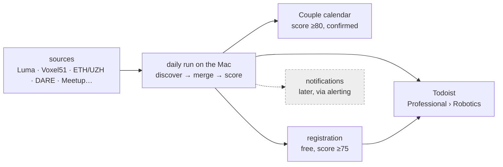

# robotics-radar

**Finds robotics and Physical AI events in Zürich/Switzerland for the next six months, puts the good ones in Todoist and the Couple calendar, and registers me for the free ones.**

State (2026-10-20): design only, no code yet. ChatGPT's scheduled task still does the discovery until phase 3 of [DESIGN.md](DESIGN.md).

| File | What |
|---|---|
| [REQUIREMENTS.md](REQUIREMENTS.md) | what it must do, the decided questions |
| [DESIGN.md](DESIGN.md) | how, the phases of the migration from ChatGPT, the open points |
| [AGENTS.md](AGENTS.md) | rules for agents, the vocabulary |
| [doc/SOURCES.md](doc/SOURCES.md) | where events come from |
| [data/historical-events.json](data/historical-events.json) | ChatGPT's past leads, unverified |
| [config/config.example.yaml](config/config.example.yaml) | the settings' keys; real values in `~/.config/robotics-radar/config.yaml` |

Public repository: no ids, emails, tokens, calendar contents or Todoist exports here.
