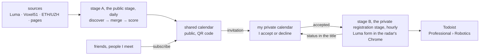

# robotics-radar

| Stage | What I get |
|---|---|
| **stage A, the public stage** | a shareable calendar of robotics and Physical AI events near Zürich, always up to date |
| **stage B, the private registration stage** | I accept an event, I am registered; the status shows in the title of the event in my private calendar (`🤖 ✅ …`, `⏳ pending: …`) |

State (2026-10-28): both stages run on the Mac; B registers for real (the last click on Luma is on since 2026-10-21) and shows the status since 2026-10-28.

| File | What |
|---|---|
| [REQUIREMENTS.md](REQUIREMENTS.md) | what it must do, the decided questions |
| [DESIGN.md](DESIGN.md) | how, the phases of the migration from ChatGPT, the open points |
| [AGENTS.md](AGENTS.md) | rules for agents, the vocabulary |
| [doc/SOURCES.md](doc/SOURCES.md) | where events come from |
| [data/historical-events.json](data/historical-events.json) | ChatGPT's past leads, unverified |
| [config/config.example.yaml](config/config.example.yaml) | the settings' keys; real values in `~/.config/robotics-radar/config.yaml` |

Public repository: no ids, emails, tokens, calendar contents or Todoist exports here.
